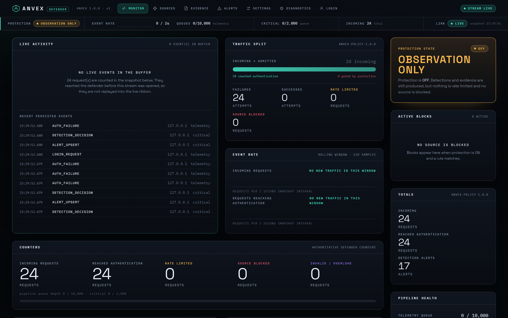
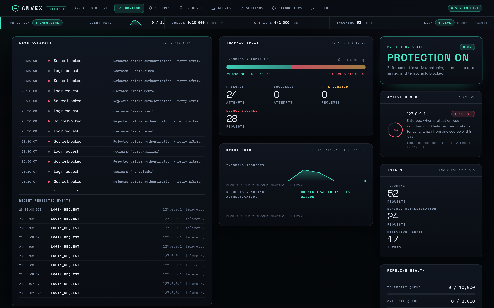
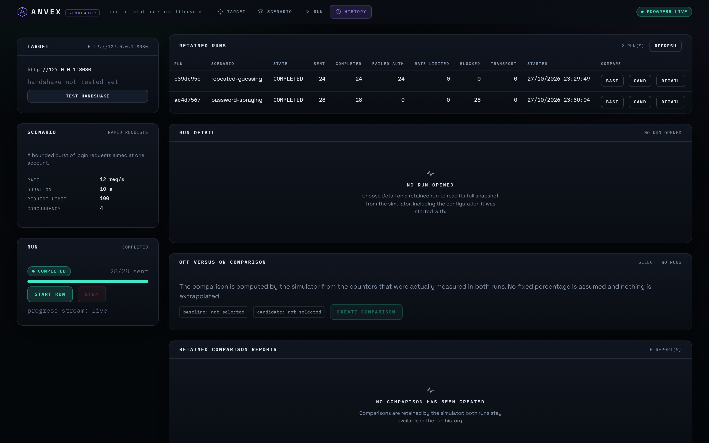

# ANVEX

### Explainable Authentication Threat Detection & Response Lab

**ANVEX** is a controlled cybersecurity experimentation platform. A Java-based **simulator** generates real HTTP authentication traffic against a separate Java **defender**, which independently detects suspicious behavior, records inspectable evidence, and optionally enforces application-level protection. Two web consoles make the full sequence observable.

**Built for cybersecurity education, investigation, and reproducible experiments — not for attacking third-party services or protecting production identity systems.**

**Stack:** Java 21 · Spring Boot · React · TypeScript · Vite · H2 · Flyway · JUnit 5 · SSE



> **Current state:** The original Java 21 platform includes tested authentication/detection/protection flows, evidence, a simulator, and an OFF/ON comparison. An **experimental Mission Control** screen has been integrated into the simulator frontend and API, but its complete cross-platform release and two-laptop behavior still require validation. Screenshots here show the original verified v1 interface, not the new Mission Control screen.

## Why ANVEX exists

Many security demos stop after showing an attack counter. ANVEX connects **the activity, the detection rule, the defensive decision, the evidence, and the measured outcome**. It makes defensive engineering decisions inspectable rather than treating detection as a black box.

## What it demonstrates

| Capability | Implementation |
| --- | --- |
| Controlled traffic generation | Separate Java simulator with bounded scenarios and a mandatory ANVEX identity/version handshake |
| Independent detection | Server-side rolling windows; scenario labels are **not** trusted for classification |
| Detection patterns | Suspected repeated guessing, suspected password spraying, unusually rapid login requests |
| Enforcement | Configurable per-source token bucket and temporary source blocks; protection can be turned OFF to observe only |
| Evidence | Rule matches, thresholds, observed counts, timestamps, policy version, associated request references, and response action |
| Live analysis | React dashboards consuming JSON snapshots and server-sent events with reconnection handling |
| Reproducible comparison | Simulator tracks actual completed requests, authentication outcomes, rejections, and latency for protection OFF vs ON |
| Persistence | H2, Flyway migrations, bounded event queues, recorded analyst actions and policy state |

### Request-to-response path

```text
Simulator (Java HttpClient)         Defender (Spring Boot)
       |                                    |
       |  HTTP login request                |
       +----------------------------------->|
                                            | 1. Count request and examine rolling window
                                            | 2. Apply active block / token bucket (if ON)
                                            | 3. Verify dummy account credentials (if admitted)
                                            | 4. Evaluate behavioral detection rules
                                            | 5. Produce evidence and optionally enforce block
                                            | 6. Queue events for persistence + live updates
       <------------------------------------+
       HTTP result (success/failure/429/503)
```

The attacker simulator and defender do not share a detection label. The defender classifies observed behavior using its own counters and timestamps.

## Screenshots

| Live monitoring | Measured experiment comparison |
| --- | --- |
|  |  |

Additional original v1 screenshots live in [`docs/screenshots/`](docs/screenshots/).

## Quick start (developer)

**Prerequisites:** JDK 21, Node.js 20.19+ (22 recommended), npm, and an internet connection for the first dependency installation. The Maven Wrapper downloads Maven on first use. Packaged Java distributions require only JDK/JRE 21.

### Windows PowerShell

```powershell
git clone https://github.com/VKarthikS/anvex-security-lab.git
cd anvex-security-lab
powershell -ExecutionPolicy Bypass -File scripts\dev-start.ps1
```

### macOS / Linux

```bash
git clone https://github.com/VKarthikS/anvex-security-lab.git
cd anvex-security-lab
bash scripts/dev-start.sh
```

The dev-start scripts install frontend dependencies, build both React apps, package the Java services, then start both services. Once healthy:

- **Defender console:** <http://127.0.0.1:8080>
- **Simulator / Mission Control:** <http://127.0.0.1:8081>

**Run the checks manually:**

```bash
npm ci --prefix frontend
npm run typecheck --prefix frontend
npm run build --prefix frontend
bash ./mvnw -B clean verify
```

On Windows, replace the final line with `.\mvnw.cmd -B clean verify`.

### Safe demo walkthrough

1. Start the defender and simulator locally. Verify that the simulator recognizes the **ANVEX** handshake.
2. Begin with protection **OFF** and run the **repeated guessing** scenario using seeded dummy users.
3. Inspect detector rule evidence, observed counters, and alert timestamps on the defender.
4. Reset/baseline according to the demo guide; enable protection **ON** and repeat the scenario.
5. Review measured blocks, rejected requests, alerts, and the simulator comparison report. Do not assume a fixed percentage improvement.

See [`docs/DEMO_SCRIPT.md`](docs/DEMO_SCRIPT.md) for a longer guided session and [`docs/OPERATIONS.md`](docs/OPERATIONS.md) for two-machine configuration.

## Repository map

```text
common/       Shared Java protocol records and response contracts
simulator/    Traffic scenarios, HTTP client, run management, report/overview APIs
  frontend → frontend/apps/simulator (including experimental Mission Control)
defender/     Authentication, detection, protection, persistence, analyst APIs
  frontend → frontend/apps/defender
frontend/    Two React/Vite apps + shared design system and typed API client
docs/        Verification record, operations, API contract, design, screenshots
scripts/     Development, demo connectivity, smoke test, release helpers
.github/     Automated build and test workflow
```

## Engineering decisions worth reviewing

- **Explainability:** Independent, deterministic rule evaluation and policy snapshots rather than an invented 'AI confidence' score.
- **Concurrency:** Per-source locking for multi-step detection decisions, instead of assuming a concurrent map alone makes a decision atomic.
- **Security separation:** Analyst mutation controls are loopback-restricted; simulator is not permitted to toggle protection through its ordinary API.
- **Safety:** The simulator expects an ANVEX identity handshake, disables redirects, and caps requests, concurrency, and duration.
- **Operational visibility:** Bounded queues, telemetry aggregation/drop counters, and an explicit overload pathway.

For implementation details, read [`ARCHITECTURE.md`](ARCHITECTURE.md) and [`docs/API_CONTRACT.md`](docs/API_CONTRACT.md).

## Honest limitations

ANVEX is a **laboratory**, not a general-purpose intrusion detection system or production authentication gateway. It uses seeded dummy accounts, deliberately narrow behavioral heuristics and an embedded database. Its two-laptop demonstration is LAN-oriented and uses HTTP without TLS by default. A source-IP block may affect legitimate clients sharing the same address. Suspected spraying cannot prove password reuse. The earlier verification log does **not** include a real two-machine physical test or a statistically rigorous detection study. The new Mission Control feature needs additional end-to-end testing.

See [`SECURITY.md`](SECURITY.md), [`docs/VERIFICATION.md`](docs/VERIFICATION.md) and [`docs/ROADMAP.md`](docs/ROADMAP.md).

## Project status and authorship

ANVEX began as a student cybersecurity project. This repository is maintained under [@VKarthikS](https://github.com/VKarthikS) to document and expand the engineering work. Contributors to the original team implementation should be acknowledged in the repository once confirmed.

No open-source license has yet been selected. Until one is added, the repository is publicly viewable but does **not** automatically grant reuse rights.
