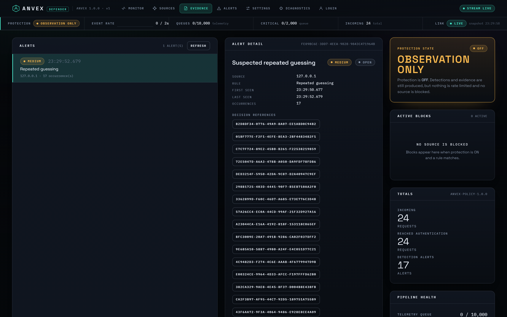
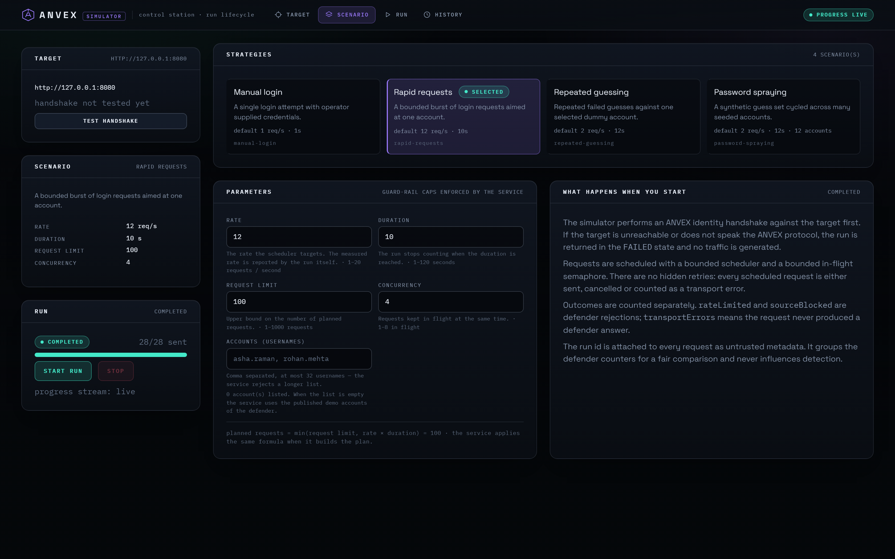
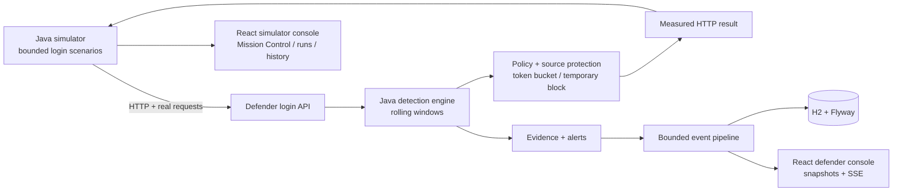

# ANVEX — Authentication Threat Detection & Response Lab

**Watch a controlled attack. See the detection decision. Inspect the evidence. Measure the defense.**

[](https://github.com/VKarthikS/anvex-security-lab/actions/workflows/ci.yml)

ANVEX is a two-service cybersecurity lab built with **Java 21, Spring Boot, React, and TypeScript**. Its simulator sends real HTTP authentication requests to a separate defender. The defender independently detects suspicious activity using configurable, time-windowed rules, creates inspectable evidence, and optionally enforces source-level protections. The UI displays server measurements rather than generating fake attack data.

> **Scope:** ANVEX is an educational blue-team engineering environment with dummy accounts. It is **not** a production authentication gateway or a tool for testing third-party targets.

**Original ANVEX student project team:** **Akshit Taran Donthu · Korem Sai Rithvik Reddy · Venkata Karthik Samula** (CBIT). The repository is currently maintained by [@VKarthikS](https://github.com/VKarthikS); hosting this repository does not imply sole authorship of the original team project.


## See ANVEX in two minutes

| Moment | What you demonstrate | What the viewer learns |
|---|---|---|
| **1. Establish baseline** | Open the defender dashboard, show Protection **OFF** | Security telemetry can be collected without enforcing restrictions |
| **2. Generate traffic** | Run **Repeated Guessing** against seeded dummy account(s) | Requests are made by the Java simulator, not animated by the browser |
| **3. Investigate evidence** | Open the matching alert and the evidence dossier | The defender identifies a rule, threshold, time window, and action independently |
| **4. Enable defense** | Reset the demo baseline; switch Protection **ON** and repeat **the exact same scenario/settings** | The defender begins rate limiting and may temporarily block the source |
| **5. Compare results** | In History, compare the completed baseline and protected runs | The report uses measured results and flags incomplete, tiny, or non-matching experiments |

**Start here:** [Two-minute showcase guide](docs/PORTFOLIO_SHOWCASE.md) · [Full demonstration](docs/DEMO_SCRIPT.md) · [Architecture](ARCHITECTURE.md)

**Recording tip:** In Simulator → Mission Control, choose **Presenter view** in the header to hide the left-hand controls and show the live experiment at a readable size. Always record actual runs. The presentation mode changes only layout, not measurements or detection logic.

**Actual interface screenshots from the original v1 build:**

| Detection evidence | Simulator scenario controls |
| --- | --- |
|  |  |

The React simulator now contains **Mission Control**, a guided view of the live authentication experiment. It correlates defender decisions with simulator requests using **defender-issued request IDs**, never timestamps alone, and inspects the 20 most recent decisions. **Presenter View** in the simulator header expands the dashboard for a readable demo or screen recording. The maintainer has reported a successful local two-service walkthrough on Windows; a two-physical-laptop LAN test and independently verified security efficacy study remain outstanding. The screenshots above are from the original v1 build, not staged Mission Control results.

## How it works



The simulator cannot declare what type of attack the defender detected. The defender evaluates its **own timestamped observations**; submitted scenario identifiers are never detection evidence.

### Security decisions visible in the code

| Engineering concern | ANVEX implementation |
| --- | --- |
| **Behavioral detection** | Repeated guessing, suspected password spraying, unusually rapid requests; server-controlled rolling windows |
| **Defensive enforcement** | Source-scoped token bucket, temporary blocks, ON/OFF observation mode, audited unblock |
| **Explainable response** | Evidence includes triggering requests, observed counts, rule thresholds, timestamps, policy snapshot, action |
| **Concurrency** | Per-source locks protect multi-step counting and decision logic |
| **Operational reliability** | Bounded event queues, clear overload handling, H2 persistence, server-sent event reconnect behavior |
| **Experiment integrity** | Separate transport errors from 429 rejections; comparable runs must have the same scenario, target and accepted configuration |
| **Controlled scope** | Seeded dummy accounts, ANVEX identity handshake, disabled redirects, simulation request/concurrency caps |

Key source entry points: [DetectionEngine](defender/src/main/java/com/anvex/defender/detection/DetectionEngine.java) · [LoginPipeline](defender/src/main/java/com/anvex/defender/security/LoginPipeline.java) · [ExperimentService](simulator/src/main/java/com/anvex/simulator/experiment/ExperimentService.java) · [Mission Control](frontend/apps/simulator/src/views/MissionView.tsx)

## Run locally

**Requirements:** Java 21, Node.js 22 (or compatible Node 20.19+), npm. Maven is bootstrapped by the included wrapper. First build requires network access for dependencies.

**Windows PowerShell**

```powershell
git clone https://github.com/VKarthikS/anvex-security-lab.git
cd anvex-security-lab
powershell -ExecutionPolicy Bypass -File scripts\dev-start.ps1
```

**macOS / Linux**

```bash
git clone https://github.com/VKarthikS/anvex-security-lab.git
cd anvex-security-lab
bash scripts/dev-start.sh
```

Open **Defender** at <http://127.0.0.1:8080> and **Simulator / Mission Control** at <http://127.0.0.1:8081>.

**Validate source and tests:**

```bash
npm ci --prefix frontend
npm run typecheck --prefix frontend
npm run build --prefix frontend
bash ./mvnw -B --no-transfer-progress clean verify
```

On Windows, use `./mvnw.cmd` in place of `bash ./mvnw`. CI performs these checks on each pull request and pushes to `main`. See [Operations](docs/OPERATIONS.md) for two-machine networking and troubleshooting.

## Project layout

```text
common/       Shared protocol DTOs
simulator/    Java HTTP traffic generator, run lifecycle, measured comparisons
              + same-origin overview endpoint for Mission Control
defender/     Authentication, rules, protection, evidence, event processing, persistence
frontend/    React/TypeScript apps + shared API clients, components, design tokens
docs/        Verification records, live demo guides, screenshots, API contracts
scripts/     Build, connectivity, smoke-test and release helpers
.github/     Continuous integration
```

## What is verified and what isn't

- **Automated verification:** GitHub Actions builds the React apps, type-checks TypeScript, and runs the Java 21 Maven test suite on pull requests and pushes to `main`. Check the live CI badge for the newest result.
- **Maintainer-reported local validation:** The defender and simulator opened on Windows, and the controlled test scenarios completed. This report has not yet been independently reproduced from a fresh clone.
- **Still outstanding:** A recorded end-to-end portfolio demo, two physical laptops communicating across a LAN, broad false-positive evaluation, production TLS/authentication hardening, and statistically significant detection accuracy.

See [Verification](docs/VERIFICATION.md), [Roadmap](docs/ROADMAP.md), and [Security & limitations](SECURITY.md). The project is a learning lab: the classifier does **not** prove password reuse, and source-IP blocks may affect legitimate users behind shared NAT.

## Credits and use

ANVEX originated as a collaborative Java Programming course-end project at Chaitanya Bharathi Institute of Technology (CBIT). Its original student project team was:

- **Akshit Taran Donthu**
- **Korem Sai Rithvik Reddy**
- **Venkata Karthik Samula**

The current portfolio repository is maintained under [@VKarthikS](https://github.com/VKarthikS). GitHub commit history and repository ownership alone should **not** be treated as the full record of the original project team's contributions. Specific responsibilities and source-code authorship should be documented only after verification with the team. Please retain original team attribution in presentations, portfolio descriptions, and derivatives.

This repository has **no open-source license yet**; public visibility alone does not grant reuse rights.

For implementation discussions, see [Interview notes](docs/INTERVIEW_NOTES.md).
